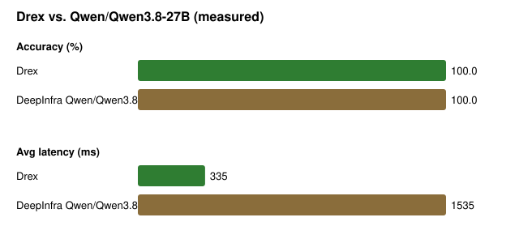

# LettuceDecide — your week of meals, decided by Drex

LettuceDecide turns a family's recipe cards and fridge photos into a Monday–Sunday meal plan and a shopping list sorted by store section. Click any meal photo to see its full recipe.

**Track:** Apex Predator · **Built for:** Drexathon (Nace AI Hackathon, San Francisco)

## Tools used

| Tool | Where it is used |
|---|---|
| **Drex** (Nace System 1) | Sorts every shopping-list item into a store section, with a confidence score per item ([`drex.py`](drex.py), `/api/store-sections`). Works out what each Ask Lettuce request means (`/api/ask-intent`). Benchmarked against an LLM in [`benchmark.py`](benchmark.py). Also System 1 inside Intern. |
| **Intern** | Coding agent used to build this repo, running with Drex as System 1 and DeepInfra as System 2. Project rules: [`AGENTS.md`](AGENTS.md); evidence: [`docs/intern_evidence.md`](docs/intern_evidence.md). |
| **DeepInfra** | Vision model that reads ingredient photos and recipe cards (`/api/analyze-ingredients`, `/api/extract-recipe`). Also Intern's System 2 and the LLM baseline in the benchmark. |
| **KeenAble** | "Research with KeenAble" searches for recipe ideas and substitutions (`/api/research-recipes`). |
| **Adobe Express** | Presentation. |

## Demo flow

Upload ingredient photos → **Analyze ingredients** (DeepInfra vision) → confirm the ingredients → **Plan my week** → the shopping list is sorted by Drex → click a meal photo to view its recipe → ask Lettuce for changes (e.g. "make Wednesday vegetarian").

How the week is chosen: recipes are ranked by how many of their ingredients you already have, then by shorter prep time, rotating for variety each time you replan. Items you have are removed from the shopping list.

## Run locally

```bash
cp .env.example .env      # add NACE_API_KEY, DEEPINFRA_API_KEY, KEENABLE_API_KEY
python3 server.py         # http://localhost:8000  (PORT=8010 python3 server.py to change the port)
```

Keys stay on the local Python server and are never sent to the browser. If a key is missing, the related feature shows an error. The shopping list falls back to built-in rules and Ask Lettuce falls back to keyword matching.

## Benchmark: Drex vs. an LLM

```bash
python3 benchmark.py
```

The benchmark makes 107 decisions per model, one decision per call for both models: 45 store-section labels (hand-written answer key in `benchmark.py`), plus 31 "vegetarian?" and 31 "weekday-friendly?" (30 minutes or less) answers taken from the recipe data. Both models get the same instructions and options. For the LLM, any `<think>` block is removed, and a reply that isn't exactly one allowed option counts as **invalid**.

Results are saved in [`results/`](results/): `summary.md` (table), `summary.json`, `benchmark_rows.csv` (every decision), and `chart.svg`.

**Result (measured Nov 14, 2026):** Drex matched the LLM's accuracy and answered about 4.5× faster per decision.

| Metric | Drex | DeepInfra Qwen/Qwen3.8-27B |
|---|---|---|
| Accuracy | 100.0% | 100.0% |
| Avg latency | 338 ms | 1506 ms |
| Cost / 1k decisions | not reported | $0.1182 |
| Invalid answers | 0 | 0 |
| Request errors | 0 | 0 |

107 decisions per model: 45 store sections, 31 vegetarian, 31 weekday-friendly.
Cost is what each API reported per call (Drex `usage.cost`, DeepInfra `estimated_cost`); "not reported" means the API returned no cost. Latency is wall-clock per call, 6 calls in parallel.



## Project layout

```
index.html, app.js, styles.css   buildless front end
server.py                        local server + API proxy (DeepInfra, Drex, KeenAble)
drex.py                          minimal Drex client (POST console.nace.ai/v1/systemone)
benchmark.py                     Drex vs. DeepInfra LLM
data/recipes.json                recipe dataset (ingredients, steps, diet, prep time)
public/recipes/                  recipe photos
results/                         benchmark output
```
